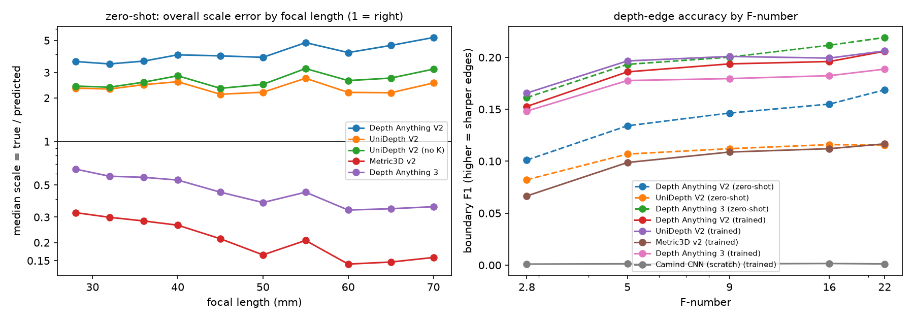
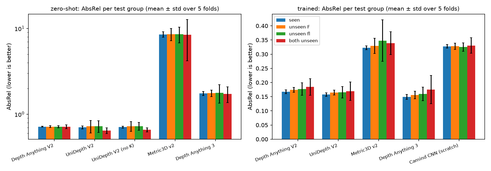
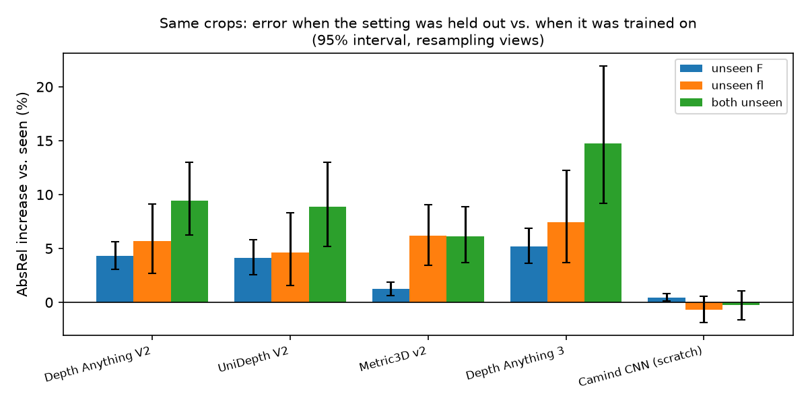
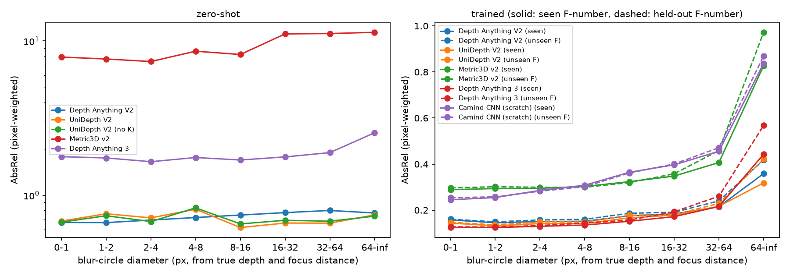

# Benchmark results: monocular metric depth under new camera settings

Last updated: 2026-10-12

This report gives the results of the full benchmark on MODEST: four pretrained metric depth models and one small CNN trained from scratch, over the five setting folds. It asks two questions:

1. How well do current models handle our camera settings out of the box (zero-shot)?
2. After training on some camera settings, how much worse are they on settings they have not seen?

The split design is in `dataset_splits.md`. Tables and figures are in `reports/benchmark/`. All of them are made by `python -m depth_bench.analyze --runs <MODEST_runs> --out reports/benchmark`.

## 1. Summary

- **Zero-shot, every model gets the metric scale badly wrong** on our native-resolution crops. Depth Anything V2 predicts depths about 5× too small, UniDepth about 2.6× too small, Depth Anything 3 about 2× too large, Metric3D about 4× too large. The **shape** of the depth map is reasonable (scale-invariant AbsRel 0.08–0.15). The scale error changes with focal length.
- **After training, the pretrained models reach AbsRel 0.15–0.17** (Depth Anything 3 best). Metric3D (0.32) and the Camind CNN (0.33) are about twice as bad.
- **Held-out camera settings cost accuracy.** For the same test crops, the pretrained transformer models are:
  - **4–5% worse** when the F-number was not trained on;
  - **5–7% worse** when the focal length was not trained on;
  - **9–15% worse** when both were not trained on.

  All of these are clearly above zero (95% intervals).
- **The loss comes mostly from extrapolation.** Holding out the extreme settings (F2.8, F22, 28 mm, 70 mm) costs the most. Holding out a setting between trained ones costs little or nothing.
- **The loss sits in strongly blurred pixels.** Up to 4 px of blur, seen and held-out F-numbers give almost the same error. At 32 px or more of blur, the held-out F-number is clearly worse (Depth Anything 3: +28% at 64+ px).
- **Blur hurts all models, even on seen settings.** Error rises 2–3× from sharp pixels to pixels with 64+ px blur. Depth edges are also less accurate at wide apertures (boundary F1 lowest at F2.8).
- **The Camind CNN shows no gap**, but it is twice as bad overall and predicts almost no depth edges. Its errors are dominated by other things, so the absence of a gap does not mean it generalizes better.

## 2. Setup in short

| | |
|---|---|
| Data | MODEST, 9 scenes, 10 focal lengths (28–70 mm), 5 F-numbers (2.8–22), stereo depth per F-number |
| Folds | 5; each hides 2 focal lengths and 1 F-number from training (S1: 50, 70 mm + F2.8; S2: 28, 45 mm + F22; S3: 32, 60 mm + F5; S4: 36, 65 mm + F9; S5: 40, 55 mm + F16) |
| Test set | the same 8,196 fixed 518 × 518 crops (no resizing) for every model and fold |
| Test groups per fold | seen; unseen F (F-number held out); unseen fl (focal length held out); both unseen |
| Pretrained models | Depth Anything V2 (metric, Hypersim, ViT-B), UniDepth V2 (ViT-B, given intrinsics), Metric3D v2 (ConvNeXt-L), Depth Anything 3 (metric, large) |
| Fine-tuning | head + last 25% of encoder blocks, 40k crops (2,500 steps of 16), SILog loss, best checkpoint by validation AbsRel |
| From scratch | Camind network as a plain two-stage CNN (3.7M parameters), no camera input, no blur supervision, 200k crops, depth MSE |
| Compute | 1 × RTX A5000 on RunPod, 33.6 h in total (25 h of training), about $9 |

The fine-tuned Metric3D uses a canonical focal length of 6,000 px instead of 1,000 px, because its decoder cannot output our depths with the official value (see `depth_bench/README.md`). Zero-shot Metric3D uses the official 1,000 px.

## 3. Zero-shot results

AbsRel per test group, mean over the 5 folds. The zero-shot predictions are the same in every fold; only the grouping changes.

| Model | Seen | Unseen F | Unseen fl | Both | Median AbsRel | Scale (true / predicted) | Scale-invariant AbsRel |
|---|---|---|---|---|---|---|---|
| Depth Anything V2 | 0.72 | 0.72 | 0.72 | 0.72 | 0.75 | 5.2 | 0.12 |
| UniDepth V2 | 0.71 | 0.73 | 0.73 | 0.65 | 0.60 | 2.6 | 0.10 |
| UniDepth V2, no intrinsics | 0.71 | 0.72 | 0.73 | 0.66 | 0.64 | 3.0 | 0.08 |
| Depth Anything 3 | 1.75 | 1.76 | 1.78 | 1.72 | 1.22 | 0.50 | 0.12 |
| Metric3D v2 | 8.54 | 8.61 | 8.61 | 8.44 | 3.87 | 0.25 | 0.15 |

- **The errors are almost all scale.** After fixing the scale of each crop with one number (scale-invariant AbsRel), the error falls to 0.08–0.15.
- **The scale error depends on focal length** (figure below, left).
  - Depth Anything V2 has no camera input. Its scale error grows from 3.6× at 28 mm to 5.2× at 70 mm: a longer lens makes objects look closer, and it predicts them closer.
  - Depth Anything 3 and Metric3D scale their output by the focal length. They overcorrect: their scale error moves the other way (Depth Anything 3: 0.64 at 28 mm, 0.35 at 70 mm).
  - UniDepth stays at about 2.1–2.7 at all focal lengths, so its use of the intrinsics removes the trend, but not the offset. Without intrinsics it is only slightly worse.
- These numbers are much worse than the models' published results. Our crops cover less than 10% of the image width, which looks like a very long telephoto lens. That is outside what these models were trained on. Zero-shot numbers on resized full images would look very different.

## 4. Trained models: seen vs held-out settings

### 4.1 Fold-averaged results

AbsRel per test group, mean over 5 folds (± standard deviation over folds).

| Model | Seen | Unseen F | Unseen fl | Both unseen | δ₁ (seen) | Boundary F1 (seen) |
|---|---|---|---|---|---|---|
| Depth Anything 3 | **0.149** ± 0.009 | **0.156** ± 0.013 | **0.160** ± 0.024 | 0.175 ± 0.050 | **0.80** | 0.18 |
| UniDepth V2 | 0.157 ± 0.006 | 0.165 ± 0.008 | 0.166 ± 0.020 | **0.169** ± 0.032 | 0.78 | **0.19** |
| Depth Anything V2 | 0.167 ± 0.006 | 0.174 ± 0.008 | 0.177 ± 0.022 | 0.184 ± 0.029 | 0.76 | 0.19 |
| Metric3D v2 | 0.323 ± 0.007 | 0.329 ± 0.027 | 0.348 ± 0.073 | 0.339 ± 0.040 | 0.45 | 0.10 |
| Camind CNN (scratch) | 0.328 ± 0.006 | 0.328 ± 0.011 | 0.325 ± 0.015 | 0.330 ± 0.027 | 0.43 | 0.00 |

- Training fixes the scale (median scale 1.01–1.15) and also improves the shape: scale-invariant AbsRel drops to 0.03 for the three best models.
- The "both unseen" group is small (about 330 crops per fold), so its fold-to-fold spread is large.

### 4.2 Paired comparison: the same crops, seen vs held out

Different test groups contain different scenes and settings, so the fold-averaged table mixes the effect of the camera setting with how hard each group's content is. Each test crop, however, is evaluated in all 5 folds: its setting is held out in one or two folds and seen in the others. So we compare, **for the same crop**, the error of the model that never saw its setting with the mean error of the models that did.

The 95% intervals come from resampling views (2,000 times), because crops of the same view are not independent.

| Model | Unseen F | Unseen fl | Both unseen |
|---|---|---|---|
| Depth Anything V2 | +4.3% [3.0, 5.6] | +5.7% [2.7, 9.1] | +9.4% [6.2, 13.0] |
| UniDepth V2 | +4.1% [2.5, 5.8] | +4.6% [1.6, 8.3] | +8.9% [5.2, 13.0] |
| Metric3D v2 | +1.2% [0.6, 1.9] | +6.2% [3.4, 9.1] | +6.1% [3.7, 8.9] |
| Depth Anything 3 | +5.2% [3.6, 6.9] | +7.4% [3.7, 12.2] | +14.7% [9.2, 21.9] |
| Camind CNN | +0.4% [0.1, 0.8] | −0.7% [−1.9, 0.5] | −0.3% [−1.6, 1.0] |

(6,552 crops for unseen F and unseen fl, 1,644 for both unseen.)

- For the four pretrained models, every gap is above zero.
- **The gap is small compared with the spread between single crops.** Only 50–60% of crops are worse when held out. The models are not failing on new settings; they are a few percent worse on average.
- **Holding out both is roughly the sum** of holding out each one.
- Depth Anything 3 is the best model on seen settings but loses the most on held-out ones.

### 4.3 Which settings are hard to hold out

Increase in AbsRel (same crops) when that setting is held out:

| Model | F2.8 | F5 | F9 | F16 | F22 |
|---|---|---|---|---|---|
| Depth Anything V2 | +8.1% | +9.6% | −1.2% | +1.2% | +8.9% |
| UniDepth V2 | +10.6% | +4.0% | 0.0% | +2.5% | +7.9% |
| Metric3D v2 | +7.3% | +0.7% | +2.1% | +0.8% | +0.4% |
| Depth Anything 3 | +16.2% | +4.0% | +6.9% | +2.1% | +5.3% |
| Camind CNN | +1.3% | +0.3% | −2.4% | +0.3% | +1.9% |

| Model | 28 | 32 | 36 | 40 | 45 | 50 | 55 | 60 | 65 | 70 mm |
|---|---|---|---|---|---|---|---|---|---|---|
| Depth Anything V2 | +13.5 | +7.3 | +0.2 | +0.8 | +7.2 | +13.5 | +9.2 | −1.3 | +0.4 | +7.7 |
| UniDepth V2 | +13.2 | +2.8 | −0.8 | +4.2 | +6.7 | +12.9 | +4.6 | −3.7 | −1.4 | +11.0 |
| Metric3D v2 | +12.0 | +6.3 | 0.0 | +2.3 | −3.6 | +23.0 | −0.3 | −9.1 | +3.7 | +22.7 |
| Depth Anything 3 | +3.5 | +2.4 | −1.1 | +6.6 | +3.0 | +25.1 | +10.6 | −0.2 | +11.8 | +20.7 |
| Camind CNN | +3.1 | +1.8 | −2.6 | −2.0 | −0.3 | +2.1 | −3.0 | −2.9 | −3.7 | +1.1 |

(% increase.)

- **Extreme settings cost the most:**
  - **F-numbers:** F2.8 (the most blur, held out in S1) and F22 (the least blur, held out in S2). With either held out, the model must extrapolate beyond the trained range.
  - **Focal lengths:** 28 mm and 70 mm, plus 50 mm.
- **Settings between trained ones (F9, F16, 36–40 mm, 60–65 mm) cost little or nothing.** Interpolating between trained camera settings works; extrapolating does not.
- **These per-setting numbers are tied to folds.** For example, 50 mm, 70 mm and F2.8 are all held out together in S1. So the 50 mm result may partly come from S1 holding out the long end of the zoom range together with the widest aperture. Each value comes from one fold and one training run.

### 4.4 Error by blur size

Each pixel's blur is computed from its true depth, the focus distance estimated for its scene, focal length and camera, and the thin-lens model. AbsRel is then averaged per blur bin (all crops, all folds).

| Blur (px) | 0–1 | 1–2 | 2–4 | 4–8 | 8–16 | 16–32 | 32–64 | 64+ |
|---|---|---|---|---|---|---|---|---|
| Share of pixels | 12% | 13% | 19% | 20% | 18% | 11% | 6% | 2% |
| Depth Anything 3, seen | 0.125 | 0.125 | 0.130 | 0.135 | 0.152 | 0.172 | 0.216 | 0.443 |
| Depth Anything 3, held-out F | 0.128 | 0.127 | 0.133 | 0.144 | 0.157 | 0.193 | 0.260 | 0.568 |
| UniDepth V2, seen | 0.144 | 0.132 | 0.142 | 0.142 | 0.166 | 0.179 | 0.217 | 0.318 |
| UniDepth V2, held-out F | 0.147 | 0.136 | 0.149 | 0.148 | 0.178 | 0.180 | 0.229 | 0.421 |
| Depth Anything V2, seen | 0.158 | 0.145 | 0.151 | 0.152 | 0.176 | 0.184 | 0.215 | 0.359 |
| Depth Anything V2, held-out F | 0.161 | 0.149 | 0.157 | 0.160 | 0.187 | 0.191 | 0.240 | 0.418 |

- **Error grows with blur for every model**, even on seen settings: from about 0.13 at under 4 px to 0.3–0.4 at 64+ px.
- **The cost of a held-out F-number is concentrated in strongly blurred pixels.** Below 8 px, seen and held-out differ by 2–7%. At 64+ px the held-out F-number is 16–32% worse. So what the models fail to carry over to a new aperture is mainly how to read strong blur.
- **Large blur happens far from the focus distance**, at the near and far ends of each scene. Part of the rise with blur may therefore come from those depths being harder anyway. The seen vs held-out comparison uses the same crops, so it is not affected by this.

### 4.5 Depth edges

Boundary F1 (Depth Pro's metric, adapted to our data; higher means sharper and better-placed depth edges):

- **Edges get worse at wide apertures** for every model: lowest at F2.8, highest at F16–F22 (figure in section 3, right).
- **Fine-tuning improves edges** for Depth Anything V2 (0.14 → 0.19), UniDepth (0.11 → 0.19) and Metric3D (0.03 → 0.10). Depth Anything 3 already has the sharpest zero-shot edges and loses a little (0.20 → 0.18).
- **The Camind CNN has almost no depth edges** (F1 about 0.001): it predicts smooth depth.
- Holding out the setting changes boundary F1 very little. The edge problem is about blur in general, not about unseen settings.

## 5. Training

| Model | Hours per fold | Validation AbsRel at start → best | Best step (of total) |
|---|---|---|---|
| Depth Anything V2 | 0.6 | 0.74 → 0.17 | 2,250 of 2,500 |
| UniDepth V2 | 0.7 | 0.73 → 0.14 | 2,300 of 2,500 |
| Metric3D v2 | 1.0 | 1.22 → 0.29 | 2,200 of 2,500 |
| Depth Anything 3 | 1.0 | 1.49 → 0.14 | 2,350 of 2,500 |
| Camind CNN | 1.7 | 1.00 → 0.34 | 8,250 of 12,500 |

The pretrained models reach their best near the end of training. A longer budget might lower their errors a little. The Camind CNN stops improving after about two-thirds of its budget.

## 6. Limitations

- **One training run per fold and model.** The fold-to-fold spread is shown, but not the spread between random seeds.
- **Train and test share scenes.** Test views are new views of the 9 training scenes. The study is about new camera settings, not new scenes.
- **Per-setting results are tied to folds.** Each focal length and F-number is held out in exactly one fold, together with two other settings.
- **Ground truth is stereo depth.** It has errors of its own, especially at edges and on surfaces without texture. Its edges are spread over about 4 pixels, which is why boundary F1 is computed on every 4th pixel.
- **The blur values are estimates.** They use the thin-lens model and our estimated focus distances, and they ignore diffraction (about 4–5 px at F22).
- **Metric3D is likely under-represented.** It needed a changed canonical focal length to train at all on our data, and its training recipe was not tuned for it. Its fine-tuned results should not be read as a fair score of the method.
- **The Camind CNN is used in a reduced form.** It runs without its camera correction, focus-distance input and blur supervision. It is a baseline for "a small CNN with no camera information", not a test of the Camind method.
- **The zero-shot numbers are for narrow native-resolution crops,** which is far from how these models are normally used.

## 7. Files

| File | Content |
|---|---|
| `depth_bench/analyze.py` | makes all tables and figures below |
| `reports/benchmark/table_groups.csv` | all metrics per stage, model and test group (mean and std over folds) |
| `reports/benchmark/table_paired.csv` | paired seen vs held-out comparison with 95% intervals |
| `reports/benchmark/table_by_fnumber.csv`, `table_by_focal.csv` | paired comparison per F-number and focal length |
| `reports/benchmark/table_blur.csv` | AbsRel per blur bin |
| `reports/benchmark/table_zs_scale_by_focal.csv`, `table_bf1_by_fnumber.csv`, `table_training.csv` | zero-shot scale, boundary F1, training summary |
| `reports/benchmark/fig_*.png` | figures in this report |
| raw results | `MODEST_runs` from RunPod (`eval/*/per_crop.csv`, `summary.csv`, `blur_summary.csv`; checkpoints in `finetune/*/best.pt`) |
