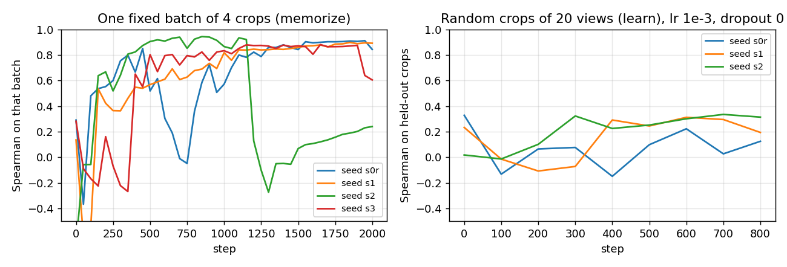
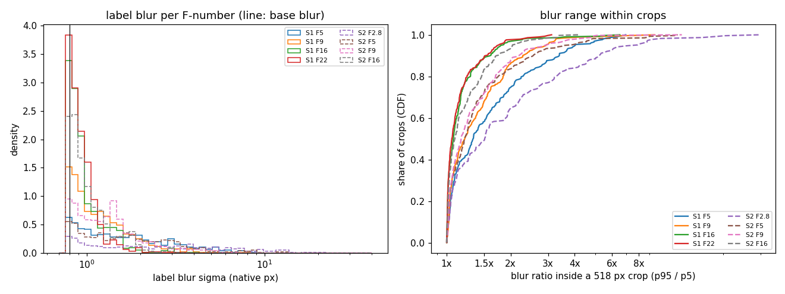
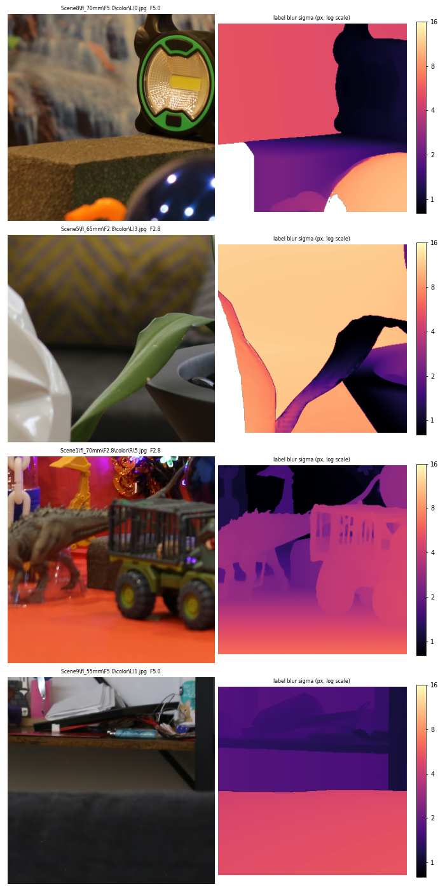
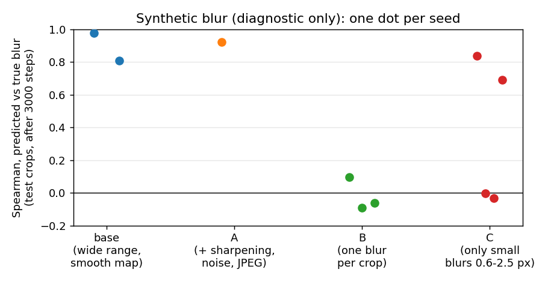
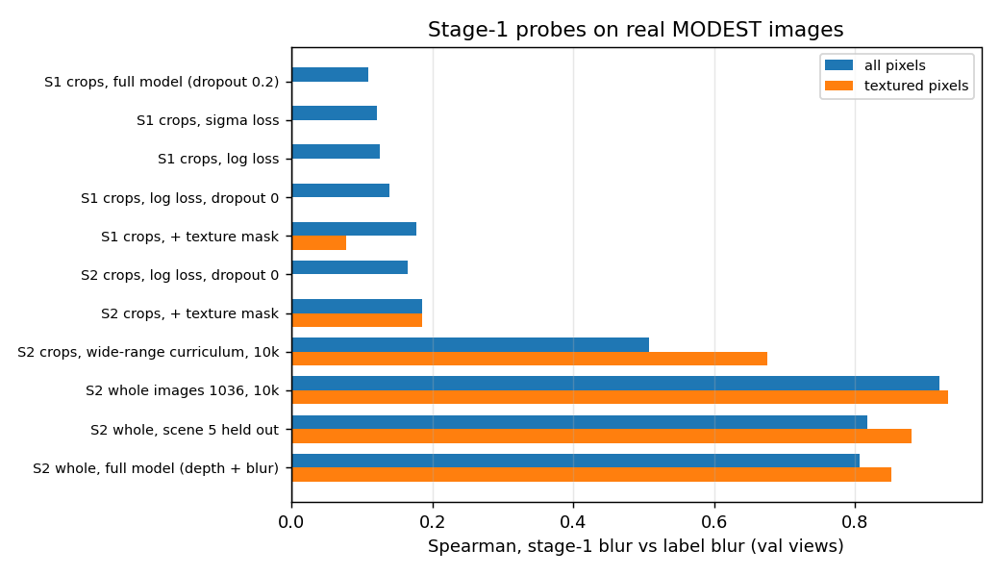
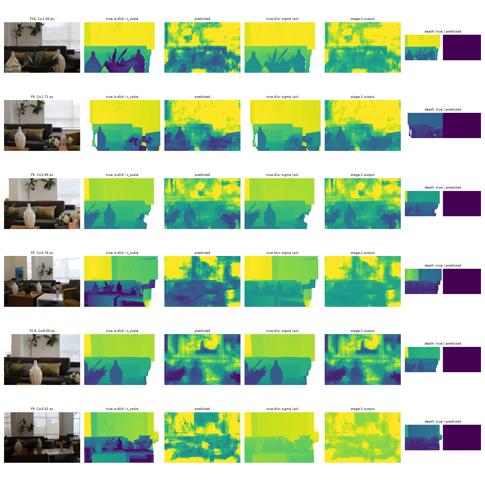
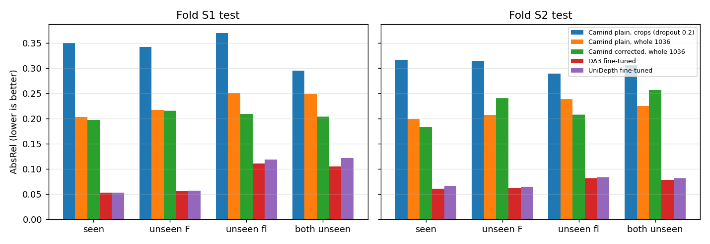
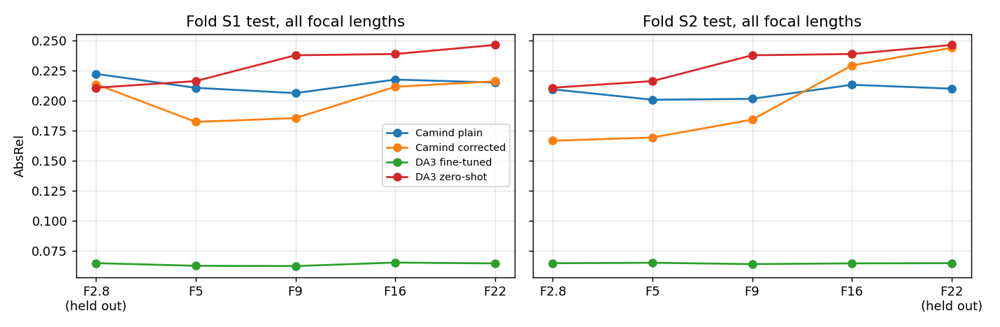
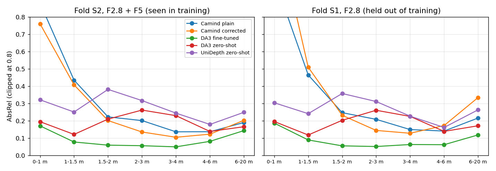
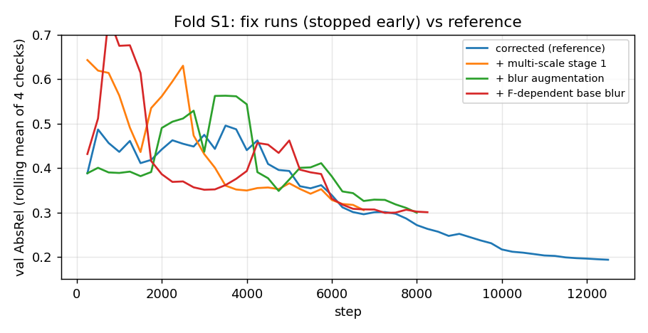

# Learning depth from defocus on MODEST with Camind

Last updated: 2026-10-20

This report covers everything we tried with the Camind network on MODEST, from 2026-10-13 to 2026-10-20:

- why its blur stage first failed to learn;
- how we fixed that;
- how the camera-corrected model then compares with the plain model and with the pretrained baselines;
- why it does not transfer to unseen F-numbers;
- what we tried next, and what is left for future work.

**Scope.** Monocular depth only: one image in, one depth map out. We never compare the same view across F-numbers. All reported models are trained only on MODEST. Synthetic blur is used only as a diagnostic, never to train a reported model.

**Files.**
- Figures and tables: `reports/blur_learning/` (made by `depth_bench/diagnostics/report_figures.py`).
- Diagnostic outputs: `reports/blur_learning/diag/` (scripts in `depth_bench/diagnostics/`, see its README).
- Pod results (eval summaries, check_blur outputs, training logs): `/workspace/MODEST_runs` on the pod. The files used here were copied to `D:\datasets\MODEST_out\pod_results_20261020` on 2026-10-20.

## 1. Summary

1. **Stage 1 at first did not learn blur at all.** Two things caused this:
   - **A dropout bug.** Dropout sat right before a max-pool. That makes train and eval mode give different outputs (eval depth scale +24%). We fixed it (dropout 0).
   - **Native 518 px crops have almost no blur range inside them.** In a typical crop the largest blur is only about 1.1–1.2× the smallest. The network never sees sharp and blurred parts of the same scene side by side, so it cannot learn what blur looks like. A synthetic test confirmed this: with one blur per crop, learning fails in 3 of 3 seeds.
2. **Whole images, resized to 1036 px, fix it.** Stage 1 then predicts blur well: Spearman 0.92 against the label blur, 0.88 on a scene it never saw in training. So the claim "MODEST has too little blur to learn from" is **not** supported. The problem was how we cut the images.
3. **The camera correction helps where it should, on settings seen in training:**
   - It cuts the error at wide apertures: F2.8 −21%, F5 −16% (fold S2).
   - It transfers to unseen **focal lengths**: AbsRel 0.208 vs 0.250 (S1) and 0.207 vs 0.238 (S2) for the plain model.
4. **It does not transfer to unseen F-numbers.**
   - With F22 held out (S2), it is 16% worse than the plain model on F22.
   - With F2.8 held out (S1), it only ties the plain model on F2.8 (0.213 vs 0.222). It is good at 2–4 m but bad near (< 1.5 m) and far (> 4 m).
   - The reason: stage 1 cannot read blur sizes outside its training range. F2.8 near and far gives blurs larger than anything at F5–F22.
5. **Camind stays far behind the fine-tuned baselines.** Its overall AbsRel is 0.18–0.20, against 0.05–0.06 for fine-tuned DA3 and UniDepth. It does beat **zero-shot** DA3 at 2–4 m on wide apertures (0.10–0.14 vs 0.23–0.26). The gap comes from a small CNN trained from scratch on 9 scenes, against foundation models that already know scene shape.
6. **Four fixes for the unseen-F problem** were started (multi-scale stage 1, blur augmentation, F-dependent base blur, motion-blur term). They were stopped at 54–66% of training, with no result yet. Their validation curves track the reference run.

## 2. Background

### 2.1 Camind and the camera correction

Camind (`depth_bench/camind_net.py`, `AENet`) has two stages:

1. **Stage 1** predicts the blur σ (in pixels) at each pixel from the image.
2. **Stage 2** turns blur into depth.

**The blur model.** For a point at depth d, with focal length f, F-number N and focus distance s:

  σ² = σ₀² + (C · |s − d| / d)²,  C = k · f² / (N (s − f))

- σ₀ is the base blur of the camera (0.62–0.8 px; `base_blur.md`).
- k ≈ 36,000 /m converts the blur-circle size into a Gaussian σ in pixels (`base_blur.md`).
- C says how much blur this camera setting makes per unit of |s − d|/d. At F2.8 it is about 17 px; at F22 about 1.3 px.

**The camera correction** (`camind_corr`). Stage 1's σ has σ₀ removed and is then divided by C. That gives an estimate of x = |s − d|/d, which no longer depends on the camera. Stage 2 gets x and the focus distance s, and predicts depth. In principle, this lets the model work on camera settings it has not seen.

**The plain model** (`camind`) has the same network, but no camera input and no blur supervision. It is the "small CNN without camera information" baseline.

**Training losses.** Depth MSE plus a stage-1 loss on the label blur. The label blur is computed from the stereo depth with the formula above. The final setting:
- loss on log(σ + 0.05) (`--stage1_space logsigma`), weight 10;
- only on textured pixels (local brightness std ≥ 0.02 in a 31 px window, `--stage1_mask 0.02`). On flat surfaces blur cannot be seen.

### 2.2 Data and folds

- MODEST: 9 scenes, 10 focal lengths (28–70 mm), 5 F-numbers (2.8, 5, 9, 16, 22).
- The depth labels are each F-number's own stereo depth.
- The focus distance s comes from `dfocus_aperture_pairs.csv` (`focus_distance_estimation.md`).
- Folds (`dataset_splits.md`) hold out one F-number and two focal lengths:

| Fold | Unseen F-number | Unseen focal lengths |
|---|---|---|
| S1 | F2.8 | 50, 70 mm |
| S2 | F22 | 28, 45 mm |

- Test groups: **seen** (both settings in training), **unseen F**, **unseen fl**, **both unseen**.

## 3. Why stage 1 did not learn blur

The first corrected Camind runs (native 518 px crops) had the same error as the plain model (AbsRel ≈ 0.32–0.34). Checking stage 1 showed that its blur output was almost constant. We tested the possible causes one by one.

### 3.1 Dropout before max-pool (a real bug)

Camind had `Dropout(0.2)` right before a max-pool.
- In training, dropout zeroes some values and multiplies the rest by 1/(1 − 0.2) = 1.25. The max-pool then picks the largest value, which is usually one of the scaled-up ones. So in training the outputs come out larger on average.
- In eval, dropout is off: nothing is scaled up. The max is smaller than what the next layers saw during training.
- Toy check: for a window of four equal values, the expected training max is 1.25× the eval max (`diag/dropout_mismatch/toy.csv`).
- On trained checkpoints: the median depth scale is **1.24 in eval mode and 1.06 in train mode**. AbsRel is 0.31 vs 0.29 (`diag/dropout_mismatch/checkpoints.csv`).

Fix: `--camind_dropout`, default 0 (commit 0cbbb43). Rerunning the plain model with dropout 0 on crops reduced the scale bias (1.15 → 1.06), but **not** AbsRel (0.34 in both cases, `table_main.csv`). So the bug was real, but it was not why stage 1 failed.

### 3.2 The code and the labels are fine

- **Labels match the images.** An independent edge-based blur estimate (Zhuo & Sim 2011) matches the label blur up to about 3 px (`fig_label_check.png`). The estimator itself reads large blurs too small (12 px reads as 5.8 px on synthetic edges), so it says little above ~8 px.
- **Image and depth are aligned** in training crops, including flipped crops (`diag/align_check`).
- **The network can fit a fixed batch.** On one batch of 4 crops, stage 1 reaches a Spearman of 0.88–0.97 at its best. But this varies a lot between batches, and some runs end low (`fig_fit.png`, left). So fitting works, but it is slow and unstable even here.
- **On a stream of random crops from 20 views,** stage 1 does not learn in 800 steps (Spearman 0.12–0.32, `fig_fit.png`, right).



### 3.3 How much blur MODEST has, and how it falls in a crop



- **Most label blurs are small.** At F16 and F22, 88–94% of pixels have σ < 1.5 px. That is about the same as the base blur and the motion blur (`scene_motion_blur.md`).
- **Large blurs exist at wide apertures.** At F2.8 the median is 5.3 px and the 95th percentile is 18 px (fold S2, `diag/blur_stats/per_fnumber.csv`).
- **Inside one 518 px crop, the blur hardly changes.** The median ratio of the 95th to the 5th percentile blur in a crop is 1.11 (S1) and 1.18 (S2). Even at F2.8 it is only 1.5. Native crops cover a small part of the full image, so a crop rarely contains both sharp and blurred parts.



### 3.4 Synthetic blur (diagnostic only)

To see which property of the data blocks learning, we applied synthetic blur to sharp (3× shrunk) MODEST crops (`synth_blur.py`, 3,000 steps):

| Variant | What it tests | Learns? (Spearman on test crops) |
|---|---|---|
| base | smooth random blur map per crop, 0.5–10 px | yes, 2 of 2 seeds (0.98, 0.81) |
| A | base + JPEG-like sharpening, noise and compression | yes (0.92) |
| B | **one uniform blur per crop** | **no, 0 of 3 seeds** (−0.09 to 0.10) |
| C | smooth maps, but only **small blurs (0.6–2.5 px)** | 2 of 4 seeds (0.84, 0.69; two at 0.0) |



What this shows:
- **Camera processing is not the problem** (A learns).
- **No blur range within a crop stops learning completely** (B). The network needs to compare sharp and blurred parts of the same image. Real native crops are close to case B.
- **Small blurs make learning unreliable,** but not impossible (C).

### 3.5 Probes on real images

A probe is a `camind_corr` run with only the stage-1 loss (`--depth_weight 0`), checked with `depth_bench.check_blur` on val views. The checks compare stage 1's blur with the label blur.



| Probe (`table_probes.csv`) | Spearman, all pixels | Textured pixels |
|---|---|---|
| S1 / S2 native crops: x, σ or log loss, dropout 0 or 0.2, ± texture mask, 3k steps | 0.11–0.19 | 0.08–0.18 |
| S2 native crops, 10k steps, no curriculum | did not learn (training loss stayed at 0.32) | – |
| S2 native crops, wide-range crop curriculum, 10k steps | 0.51 | 0.68 |
| **S2 whole images, resized to 1036, 10k steps** | **0.92** | **0.93** |
| S2 whole images, **scene 5 held out of training** (checked on scene 5) | 0.82 | 0.88 |
| S2 whole images, full model (depth + blur loss) | 0.81 | 0.85 |

- **Whole images work.** Resized to 1036 px on the short side, one image contains near and far parts with very different blur. The predicted median blur follows the label from about 0.4 to 4 px (`fig_probe_whole_examples.png`).
- **The wide-range curriculum helps only partly.** It picks crops with a wider blur range for the first 4k steps, and the loss only drops after that.
- **It is not memorization.** On scene 5, which it never saw in training, stage 1 reaches 0.88 against 0.93 on seen scenes. So the network reads blur, not scene layout.



**Conclusion of part 3.** Stage 1 failed on native crops because each crop has almost one blur level, the blurs are mostly small, and the runs were short. On whole images at 1036 px it learns blur well. MODEST does have enough blur for stage 1 to learn from, as long as it sees whole images.

## 4. Main results: whole images at 1036 px

All runs below:
- `finetune --resize 1036 --stage1_space logsigma --stage1_weight 10 --stage1_mask 0.02 --lr_head 1e-3 --samples 200000 --batch 2 --accum 8`, dropout 0;
- evaluated on the fold's test views with `--crops 6`.

The baselines are the pretrained models fine-tuned on MODEST at 518 px (`benchmark_results.md`).

### 4.1 Overall test AbsRel

| Fold | Model | seen | unseen F | unseen fl | both unseen |
|---|---|---|---|---|---|
| S1 | Camind plain, native crops (old) | 0.350 | 0.342 | 0.369 | 0.294 |
| S1 | Camind plain, whole 1036 | 0.203 | 0.216 | 0.250 | 0.249 |
| S1 | **Camind corrected, whole 1036** | **0.196** | **0.216** | **0.208** | **0.204** |
| S1 | DA3 fine-tuned | 0.052 | 0.056 | 0.110 | 0.104 |
| S1 | UniDepth fine-tuned | 0.053 | 0.057 | 0.118 | 0.121 |
| S2 | Camind plain, native crops (old) | 0.317 | 0.315 | 0.289 | 0.306 |
| S2 | Camind plain, whole 1036 | 0.199 | 0.206 | 0.238 | 0.224 |
| S2 | **Camind corrected, whole 1036** | **0.183** | 0.240 | **0.207** | 0.256 |
| S2 | Camind corrected + SNR input | 0.189 | 0.235 | 0.213 | 0.247 |
| S2 | DA3 fine-tuned | 0.061 | 0.062 | 0.081 | 0.078 |
| S2 | UniDepth fine-tuned | 0.065 | 0.064 | 0.083 | 0.081 |

The complete table is in `table_main.csv`.



- **Whole images help both Camind models a lot** (0.32–0.35 → 0.18–0.20).
- **The correction helps on seen settings and on unseen focal lengths.** On unseen fl, the error drops by 13–17% (0.250 → 0.208 and 0.238 → 0.207). That is what the correction is for: C accounts for the focal length.
- **On unseen F-numbers it does not help** (S1 0.216 vs 0.216). With F22 held out, it hurts (S2: 0.240 vs 0.206).
- **The SNR variant** gives stage 2 one more input, log(C/σ₀): how strongly blur reflects depth at this setting. It changes little and does not fix F22.

Note: a first evaluation of the S2 corrected model was wrong, because evaluation did not pass the resize factor (`px_scale`) for resized images. It was fixed in commit 4337c8b and re-evaluated. The wrong result is kept as `ft_camind_corr_S2_r1036_whole_bugpx`.

### 4.2 By F-number



Test AbsRel, all focal lengths (`table_by_fnumber.csv`):

| Fold | Model | F2.8 | F5 | F9 | F16 | F22 |
|---|---|---|---|---|---|---|
| S1 | Camind plain | 0.222 | 0.210 | 0.206 | 0.217 | 0.215 |
| S1 | Camind corrected | 0.213 (held out) | 0.182 | 0.185 | 0.211 | 0.216 |
| S1 | change | −4% | −13% | −10% | −3% | 0% |
| S2 | Camind plain | 0.209 | 0.201 | 0.201 | 0.213 | 0.210 |
| S2 | Camind corrected | 0.166 | 0.169 | 0.184 | 0.229 | 0.244 (held out) |
| S2 | change | −21% | −16% | −8% | +8% | +16% |
| both | DA3 fine-tuned | 0.065 | 0.063–0.065 | 0.062–0.064 | 0.065 | 0.065 |
| both | DA3 zero-shot | 0.211 | 0.216 | 0.238 | 0.239 | 0.246 |

- **The gain is largest at wide apertures,** where blur is large and carries the most depth information.
- **At F16–F22 the correction does not help, or hurts.** There, defocus blur is about as small as the base blur and the camera motion blur (`scene_motion_blur.md`). Dividing a small, noisy blur by a small C makes the x estimate noisy.

### 4.3 By distance

The error per true-depth bin (`depth_vs_distance.py`; `fig_error_vs_distance_S1.png`, `fig_error_vs_distance_S2.png`, `table_by_distance.csv`):



| AbsRel | 0–1 m | 1–1.5 | 1.5–2 | 2–3 | 3–4 | 4–6 | 6–20 m |
|---|---|---|---|---|---|---|---|
| *share of pixels* | 2% | 8% | 15% | 28% | 31% | 12% | 4% |
| **S2, F2.8 + F5 (seen)**: Camind corrected | 0.76 | 0.41 | 0.20 | **0.135** | **0.105** | 0.12 | 0.20 |
| Camind plain | 0.88 | 0.43 | 0.22 | 0.20 | 0.14 | 0.14 | 0.19 |
| DA3 fine-tuned | 0.17 | 0.08 | 0.06 | 0.06 | 0.05 | 0.08 | 0.14 |
| DA3 zero-shot | 0.19 | 0.12 | 0.21 | 0.26 | 0.23 | 0.14 | 0.17 |
| **S1, F2.8 (held out)**: Camind corrected | 1.37 | 0.51 | 0.23 | **0.144** | **0.128** | 0.17 | 0.33 |
| Camind plain | 1.02 | 0.46 | 0.25 | 0.21 | 0.15 | 0.14 | 0.22 |
| DA3 fine-tuned | 0.19 | 0.09 | 0.06 | 0.05 | 0.06 | 0.06 | 0.12 |
| DA3 zero-shot | 0.20 | 0.12 | 0.20 | 0.26 | 0.23 | 0.14 | 0.17 |

- **Camind is worst close to the camera** (< 1.5 m), with errors of 40–137%. Near objects fill a large part of the image, with fast depth changes and often little texture. Few training pixels are that close (2% below 1 m).
- **At 2–4 m and wide apertures, corrected Camind beats zero-shot DA3 by about half** (0.10–0.14 vs 0.23–0.26), but not fine-tuned DA3.
- **On held-out F2.8 (S1), the 2–4 m gain survives** (0.14 / 0.13, close to the 0.14 / 0.11 when F2.8 was seen). **Near and far, it breaks:** at 6–20 m it is worse than the plain model (0.33 vs 0.22).

**Per-view scale.** The median error of the overall depth scale per view:

| | Camind corrected | Camind plain | DA3 fine-tuned | DA3 zero-shot |
|---|---|---|---|---|
| S2, F2.8 + F5 (seen) | 7.4% | 8.5% | 3.1% | 13.8% |
| S1, F2.8 (held out) | 8.5% | 7.5% | 3.4% | 13.2% |

The correction gives a better scale than the plain model when F2.8 is seen, but not when it is held out.

## 5. Why the results look like this

### 5.1 Why Camind is behind the fine-tuned baselines

- **Model and data size.** Camind is a 3.7M-parameter CNN trained from scratch on 9 scenes. DA3 and UniDepth are large ViTs pretrained on millions of images. They already know scene shape, and fine-tuning on MODEST mainly fixes their scale.
- **Shape errors dominate.** With the best scale per view, Camind's error is still 0.10–0.18 at 1.5–6 m. DA3 fine-tuned is at 0.02–0.03 (`fig_error_vs_distance_*.png`).
- **Blur only gives depth where it can be seen.** There is no signal near the focus plane, on textureless surfaces, or at F16–F22, where blur is about as small as the base and motion blur. Blur also can't tell in front of the focus plane from behind it.
- **The baselines already get the scale right on seen settings** (3% error). So there is little left for blur to fix.

### 5.2 Why the correction does not transfer to unseen F-numbers

The correction divides out C, so in theory the F-number should not matter. In practice:

1. **Stage 1 must read blur sizes it has never seen.**
   - With F2.8 held out (S1), the largest training blurs come from F5 (95th percentile ≈ 7 px). F2.8 near and far gives up to ~18 px. Stage 1 underreads these, so x is too small, and depth is pulled toward the focus distance. That is exactly where S1 fails: near and far.
   - With F22 held out (S2), the blurs are smaller than anything in training, mostly below the base blur. Stage 1 can't separate them from σ₀, so x is noise.
2. **The blur model is not exact per F-number.**
   - σ₀ is not constant: diffraction grows with N (~1 px at F22).
   - Motion blur grows with exposure time, so it is near zero at F2.8 and 0.3–0.5 px at F9–F22 (`scene_motion_blur.md`).
   - The real aperture, vignetting and the blur shape at F2.8 may make the effective k differ by F-number (section 7.1).

   A constant error in k or s would cancel in training. An error that depends on the F-number would not.
3. **Stage 2 learns the x distribution of the seen F-numbers.** If x is biased for the new F-number, stage 2 has no way to know.

## 6. Fixes tried for unseen F-numbers (stopped)

We added four options to Camind (commit c201033), to be tested one at a time on fold S1:

| Option | Flag | What it does | Targets |
|---|---|---|---|
| Multi-scale stage 1 | `--stage1_scales 1,0.5,0.25` | Runs stage 1 on the image at 3 scales. A blur of 16 px becomes 4 px at ¼ scale, inside the trained range. The scales are combined with weights by how close each scale's blur is to 1.5 px. | blurs larger than in training (F2.8 held out) |
| Blur augmentation | `--aperture_aug 0.5 --aperture_aug_max 2.0` | For half the images, adds extra defocus blur as if the aperture were up to 2× wider. N in the camera input is divided to match. | extends the training blur range |
| F-dependent base blur | `--sigma0_diffraction` | σ₀ grows with N, as diffraction does: 0.35 px at F2.8 to 1.06 px at F22, matching 0.8 px at F16. | wrong σ₀ at the unseen F-number |
| Motion-blur term | `--motion_blur` | Adds the measured motion blur per F-number (0 at F2.8, up to ~0.6 px at F16) to σ₀. | the F9–F22 labels are too small without it |

**Status.** The pod restarted on 2026-10-19 at about 19:10 UTC, and the runs were resumed. We then stopped them on 2026-10-20:
- multi-scale at step 6,750, blur augmentation at 8,000, base blur at 8,250 (of 12,500);
- the motion-blur run never started.

The checkpoints (`last.pt`, `best.pt`) are on the pod. The runs can be resumed with `/workspace/fixes_s1.sh`.



Up to where they stopped, all three validation curves stay within the noise of the reference corrected run. There is no test result yet, so **no conclusion can be drawn** about these fixes. Either way, they target unseen-F transfer. They are not expected to close the gap to the fine-tuned baselines.

## 7. Future work

### 7.1 Check the blur model per F-number ("effective k")

The blur model assumes the same k for all F-numbers. For each F-number, we can measure the **effective k**: the ratio between the blur actually seen in the images and f²/(N(s − f)) · |s − d|/d, from the stereo depth. First fit σ² = σ₀² + (k_eff · term)² per F-number, to remove the base and motion blur.

- If k_eff is about the same for all F-numbers, the labels and the correction are consistent, and they are not the cause of the poor transfer.
- If k_eff differs (for example, smaller at F2.8 because of vignetting or the blur shape), the labels and the correction are wrong in an F-specific way. That would explain part of the transfer failure, and k could be corrected per F-number.

Two notes:
- This needs a blur estimator that works up to ~15 px (e.g. a multi-scale edge method). The one in `label_check.py` reads large blurs too small.
- A related check: **focus shift with aperture.** Does the depth of least blur move with N? That would make s wrong per F-number.

This can run on the laptop.

### 7.2 Finish the four fix runs

Resume `fixes_s1.sh` on the pod (about 8–11 h for the first three, then about 20 h for the motion-blur run). Then compare each with the corrected and plain S1 runs:
- per F-number;
- per distance, with F2.8 near and far as the main test.

If one helps, run it on S2 (F22 held out) as well.

### 7.3 Give the blur map to the pretrained baselines

This is the most promising way to get better depth than the fine-tuned baselines.
- **The extra information:** the camera-corrected blur map from the trained stage 1 (an estimate of |s − d|/d per pixel), plus two constant channels: the focus distance s and log(C/σ₀), which says how reliable the map is.
- **No label leakage:** the map comes only from the image and the camera settings. Each fold uses its own stage 1.

Three ways to feed it in:

| Option | How | Pros | Cons |
|---|---|---|---|
| **A. Extra input channels** (suggested first) | Widen the first layer (patch embedding) from 3 to 6 channels. The new weights start at zero, so at first the model behaves exactly like the pretrained one. Fine-tuning learns how much to use the blur. | A true extra input. The same idea for every model. Keeps the pretrained knowledge. | Model-specific code. The first layer, normally frozen, must be trained. |
| **B. Into the decoder** | A small network encodes the blur map. Its features are added to the decoder at several scales, starting at zero. | The encoder is untouched. Blur is a low-level cue and may fit better near the output. | More code: each decoder is different. |
| **C. Correction head on the output** | A small network takes the baseline's depth and the blur map, and predicts a correction. | Simplest, and the same for every model. | Not really an input to the model. Closer to a learned fusion. |

Suggested plan:
- A on DA3 and UniDepth, fold S2 first, then S1.
- Each with and without the blur input, same recipe and seed, so the comparison is clean.
- About 6–8 h on the pod per fold, plus ~30 min per fold to precompute the maps (~5.6 GB per fold at 518 px).
- If A ignores the extra channels, try B.

What to expect:
- Fine-tuned DA3 already has a ~3% scale error, so the gain will be small. It would show mainly at F2.8/F5 at 2–4 m.
- On F-numbers stage 1 never saw, the maps are poor, so the gain there will be limited.

### 7.4 Other open items

- **Folds S3–S5 at 1036 px.** Only S1 and S2 have whole-image Camind runs. The old native-crop runs exist for all folds.
- **Fusion** (scale a SOTA depth map with Camind's mid-range depth). Put aside for now. A first preview that used near pixels did poorly, because near is where Camind is worst. Using the 2–4 m band would be the better test.
- **Multiple seeds** for the main runs. Every main result above is one seed. The validation curves vary a lot between checks (e.g. 0.35 → 0.58 → 0.35), so differences of a few percent may not be real.

## 8. Limitations

- **One training seed per model.** The differences between the corrected and plain models at F16–F22 (a few %) may be within seed noise. The large ones (−21% at F2.8 in S2, −17% on unseen focal lengths) are much bigger than that.
- **Only folds S1 and S2.**
- **The test views are the same for all folds.** Only the training settings change.
- **The label blur depends on k, s and σ₀.** Errors in any of them go straight into the stage-1 labels (section 7.1).
- **The synthetic tests are short** (3,000 steps) and use a simple Gaussian blur. They show what blocks learning, not how well a model would do.

## 9. How to reproduce

Code: `depth_bench/` at commit c201033, plus `depth_bench/diagnostics/report_figures.py`.

```bash
# stage-1 probe (blur loss only), then the blur check
python -m depth_bench.finetune --model camind_corr --fold S2 --resize 1036 --stage1_space logsigma \
    --stage1_mask 0.02 --depth_weight 0 --lr_head 1e-3 --samples 160000 --batch 4 --accum 4 --tag probe_whole
python -m depth_bench.check_blur --model camind_corr --fold S2 --resize 1036 \
    --ckpt <RUNS>/finetune/camind_corr_S2_r1036_probe_whole/best.pt

# main runs (corrected; the plain model is --model camind with --stage1_space x and no mask)
python -m depth_bench.finetune --model camind_corr --fold S1 --resize 1036 --stage1_space logsigma \
    --stage1_weight 10 --stage1_mask 0.02 --lr_head 1e-3 --samples 200000 --batch 2 --accum 8 --tag whole
python -m depth_bench.evaluate --model camind_corr --fold S1 --resize 1036 --crops 6 --stage1_space logsigma \
    --stage1_weight 10 --stage1_mask 0.02 --ckpt <RUNS>/finetune/camind_corr_S1_r1036_whole/best.pt \
    --out ft_camind_corr_S1_r1036_whole

# error by distance, then this report's figures
python -m depth_bench.diagnostics.depth_vs_distance --fold S1
python -m depth_bench.diagnostics.report_figures --pod <copy of MODEST_runs>
```

The diagnostics in section 3 are listed in `depth_bench/diagnostics/README.md`.
